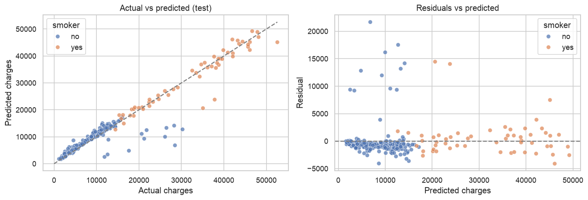
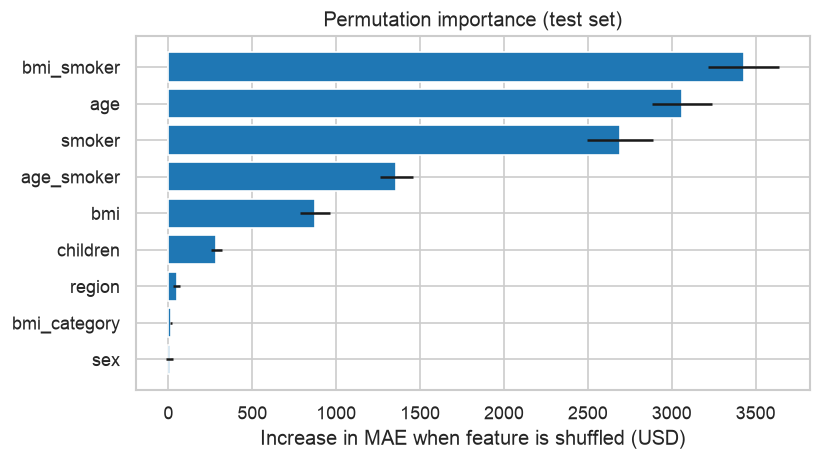

# Medical Insurance Cost Prediction

Predictive analytics project that estimates a person's **annual medical insurance charges** from their age, sex, BMI, number of children, smoking status and region. The final model is tuned Gradient Boosting with engineered interaction features and a log-transformed target. On a held-out test set it reaches **R² = 0.92** with a **mean absolute error of about $1,600**. That is about 55% lower than a linear-regression baseline.



> **Also in this repository:** [Customer Segmentation with K-Means](customer-segmentation/), which groups 200 mall customers into five marketing segments and includes an [interactive website](https://tanishqtiwari1.github.io/Medical-insurance-cost-prediction/).

## Problem statement

Insurers price policies from expected cost. This project answers two questions:

1. **Prediction:** how accurately can we estimate an individual's yearly charges?
2. **Explanation:** which factors drive cost, and how do they interact?

## Dataset

[Medical Cost Personal Dataset](https://www.kaggle.com/datasets/mirichoi0218/insurance) (Kaggle): 1,338 records (1,337 after removing one duplicate), no missing values.

| Column | Description |
|---|---|
| `age` | Age of the primary beneficiary |
| `sex` | female / male |
| `bmi` | Body mass index (kg/m²) |
| `children` | Number of dependents covered |
| `smoker` | yes / no |
| `region` | northeast, northwest, southeast, southwest (US) |
| `charges` | **Target:** annual medical cost billed (USD) |

## Approach

1. **Data quality:** check types, missing values and duplicates.
2. **EDA:** examine the target distribution (strong right skew), cost by category, and relationships with age and BMI split by smoking status.
3. **Feature engineering** ([`src/features.py`](src/features.py)), driven by the EDA:
   - `bmi_smoker` = BMI × smoker, because BMI only raises cost for smokers
   - `age_smoker` = age × smoker
   - `bmi_category`: WHO bands, which capture the jump at BMI 30
4. **Leak-free pipeline:** scaling and one-hot encoding happen inside a scikit-learn `Pipeline`. The train/test split is stratified on smoker.
5. **Model comparison:** 7 algorithms × 2 feature sets, compared with 5-fold cross-validation.
6. **Hyperparameter tuning:** `GridSearchCV` over Gradient Boosting, with and without a log-transformed target.
7. **Evaluation:** test-set MAE, RMSE and R², residual analysis, and an error breakdown by group.
8. **Interpretation:** permutation feature importance.
9. **Deployment:** saved model, a prediction function and a command-line predictor.

## Results

**Cross-validation, mean of 5 folds (selected rows):**

| Model | Features | CV MAE | CV R² |
|---|---|---|---|
| Gradient Boosting | engineered | 2,775 | 0.834 |
| Random Forest | base | 2,846 | 0.820 |
| Linear Regression | engineered | 3,067 | 0.823 |
| Linear Regression | base | 4,393 | 0.722 |

**Final test set (268 people, never seen during training or tuning):**

| Model | MAE | RMSE | R² |
|---|---|---|---|
| Baseline: Linear Regression | $3,593 | $5,087 | 0.820 |
| **Tuned Gradient Boosting + log target** | **$1,601** | **$3,303** | **0.924** |

## Key insights

- **Smoking is the biggest cost driver.** Smokers average about $32,050 a year, against about $8,440 for non-smokers.
- **BMI matters only for smokers.** Obese smokers average about $41,560, compared with about $21,360 for non-obese smokers. For non-smokers the difference is under $900.

  

- **One interaction feature changes the picture.** `bmi_smoker` is the most important feature. It lifts plain linear regression from CV R² 0.72 to 0.82.

  
  

- **Log-transforming the skewed target** reduced the tuned model's CV MAE from about $2,700 to about $2,230.
- **Sex and region** add almost no predictive value.

## Project structure

```
medical-insurance-cost-prediction/
├── data/
│   └── insurance.csv                  # raw dataset
├── notebooks/
│   └── insurance_cost_prediction.ipynb   # full analysis, with outputs
├── src/
│   ├── features.py                    # feature engineering (shared)
│   ├── train.py                       # retrain and save the final model
│   └── predict.py                     # CLI prediction for one person
├── models/
│   └── insurance_model.joblib         # trained model
├── images/                            # figures used in this README
├── requirements.txt
└── README.md
```

## How to run

```bash
git clone https://github.com/Tanishqtiwari1/medical-insurance-cost-prediction.git
cd medical-insurance-cost-prediction
python -m venv .venv && source .venv/bin/activate   # Windows: .venv\Scripts\activate
pip install -r requirements.txt
```

**Explore the analysis:**

```bash
jupyter notebook notebooks/insurance_cost_prediction.ipynb
```

**Retrain the model** (writes `models/insurance_model.joblib` and `models/metrics.json`):

```bash
python -m src.train
```

**Predict for a new person:**

```bash
python -m src.predict --age 35 --sex male --bmi 33 --children 2 --smoker yes --region southeast
```

## Limitations and future work

- The dataset is small and has no medical history, so a few very high-cost cases can't be explained.
- The test split scored higher than training (0.92 vs 0.87 R²), so the cross-validated R² of about 0.83 is the more conservative estimate.
- The model learns historical pricing. Any use in real pricing would need a fairness review.
- **Next steps:** prediction intervals with quantile regression, SHAP explanations for each person, and a Streamlit web app.

## Tech stack

Python · pandas · NumPy · scikit-learn · XGBoost · Matplotlib · Seaborn · Jupyter
