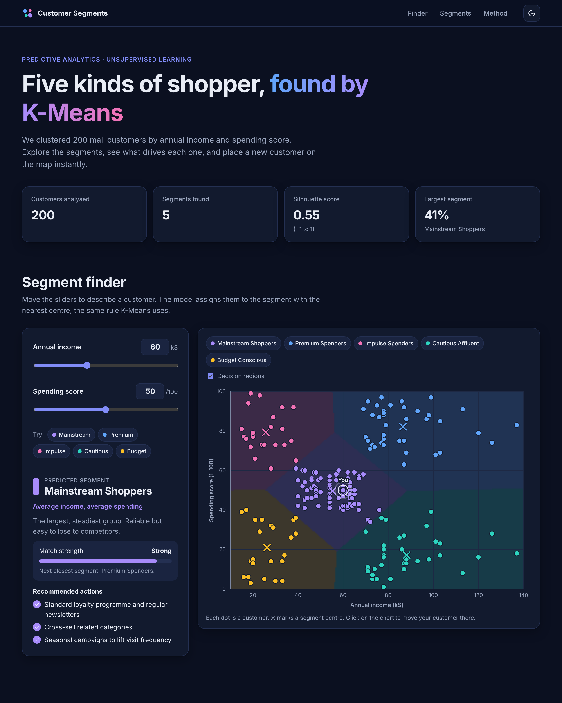
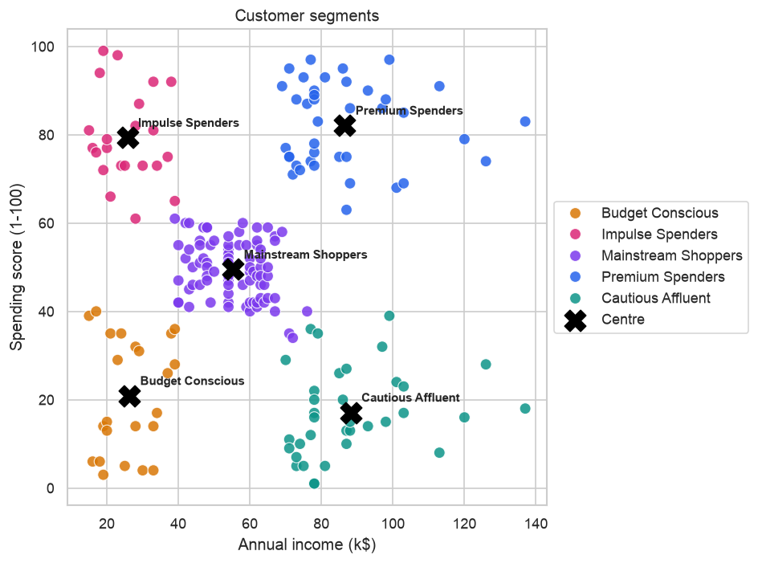

# Customer Segmentation with K-Means

Unsupervised machine-learning project that groups 200 shopping-mall customers into **five actionable segments** by annual income and spending score. It includes an **interactive website** where you can explore the segments and assign a new customer in real time.

**Live demo:** https://tanishqtiwari1.github.io/Medical-insurance-cost-prediction/



## Problem statement

A mall wants to stop sending the same promotion to everyone. The goal is to:

1. find natural groups of customers with similar shopping behaviour,
2. describe each group in business terms, and
3. recommend a marketing strategy for each group.

There is no "correct answer" column, so this is an **unsupervised learning** (clustering) problem.

## Dataset

[Mall Customer Segmentation Data](https://www.kaggle.com/datasets/vjchoudhary7/customer-segmentation-tutorial-in-python) (Kaggle): 200 customers, no missing values.

| Column | Description |
|---|---|
| `CustomerID` | Unique ID (not used for modelling) |
| `Gender` | Male / Female |
| `Age` | Age in years (18-70) |
| `Annual Income (k$)` | Annual income in thousands of dollars (15-137) |
| `Spending Score (1-100)` | Score assigned by the mall from customer behaviour and purchase data |

## Approach

1. **EDA:** distributions, correlations, and income vs spending (five visible groups). Spending falls with age (r = -0.33). Income and spending are uncorrelated.
2. **Feature selection:** cluster on income and spending score, the two behaviours marketing can act on. Gender and age are used only to profile the segments.
3. **Scaling:** `StandardScaler`, because K-Means is distance-based.
4. **Choosing k:** the elbow method and silhouette score both select **k = 5**.
5. **K-Means clustering**, then **automatic segment naming** from each cluster centre's position.
6. **Validation:**
   - Hierarchical (Ward) clustering finds the same groups (Adjusted Rand Index 0.94).
   - Results are identical across 20 random seeds.
   - Compared against DBSCAN and a 3-feature model that adds age.
7. **Deployment:** the model is exported to JSON, and the website runs the nearest-centre rule in the browser.

## Results

**Silhouette score 0.555 · Davies-Bouldin index 0.57**

| Segment | Customers | Avg income | Avg spending | Avg age | Strategy |
|---|---|---|---|---|---|
| **Premium Spenders** | 39 (20%) | 86.5k$ | 82 | 33 | VIP loyalty, early access, premium brands |
| **Cautious Affluent** | 35 (18%) | 88.2k$ | 17 | 41 | Value messaging, personalised offers (biggest upside) |
| **Mainstream Shoppers** | 81 (41%) | 55.3k$ | 50 | 43 | Standard loyalty, cross-selling, seasonal campaigns |
| **Impulse Spenders** | 22 (11%) | 25.7k$ | 79 | 25 | Trend-led and flash offers, youth loyalty cards |
| **Budget Conscious** | 23 (12%) | 26.3k$ | 21 | 45 | Discounts, bundles, essentials |



**Key insight:** *Cautious Affluent* customers earn as much as *Premium Spenders* but spend about a fifth as much. Converting even part of this group is the mall's largest growth opportunity.

## Website features (UI/UX)

The site is in [`docs/`](docs): plain HTML, CSS and JavaScript, with no build step and no backend.

- **Segment finder:** sliders and number inputs, plus one-click example customers. Shows the predicted segment, a match-strength indicator (and a warning near a boundary), the next-closest segment and recommended actions.
- **Interactive map:** all 200 customers with hover or keyboard tooltips, segment centres, shaded decision regions, legend filters, and click-to-place.
- **Segment cards:** size, averages, gender split and strategy for each segment, with a "show on the map" shortcut.
- **Method section:** pipeline steps and live elbow and silhouette charts.
- **Light and dark themes** (follows your system, with a manual toggle), a **responsive** layout for phone, tablet and desktop, and **accessibility** support: keyboard navigation, ARIA labels, a skip link and reduced-motion support.
- **Accurate:** browser predictions match scikit-learn's `KMeans.predict` for all 200 customers and a 520-point test grid.

## Project structure

```
Medical-insurance-cost-prediction/
├── data/Mall_Customers.csv
├── notebooks/customer_segmentation.ipynb   # full analysis, with outputs
├── src/segmentation.py                     # train, name segments, export
├── models/kmeans.joblib                    # trained scaler and model
├── docs/                                   # website (GitHub Pages)
│   ├── index.html
│   ├── styles.css
│   ├── app.js
│   └── data/model.json, model.js           # exported model
├── images/                                 # charts and screenshot
├── requirements.txt
└── README.md
```

## How to run

```bash
git clone https://github.com/Tanishqtiwari1/Medical-insurance-cost-prediction.git
cd Medical-insurance-cost-prediction
python -m venv .venv && source .venv/bin/activate   # Windows: .venv\Scripts\activate
pip install -r requirements.txt
```

**Open the website:** double-click `docs/index.html`, or serve it locally:

```bash
python -m http.server 8000 --directory docs
```

Then visit http://localhost:8000.

**Run the analysis:**

```bash
jupyter notebook notebooks/customer_segmentation.ipynb
```

**Retrain and re-export the website data:**

```bash
python -m src.segmentation
```

## Deploy the website (GitHub Pages)

The workflow in [`.github/workflows/pages.yml`](.github/workflows/pages.yml) publishes `docs/` whenever it changes on `main`. To turn it on once, go to the repository's **Settings → Pages → Build and deployment** and set **Source** to **GitHub Actions**. The site is then served at `https://tanishqtiwari1.github.io/Medical-insurance-cost-prediction/`.

## Limitations and future work

- Only 200 customers and 4 attributes. The spending-score formula is defined by the mall and not published.
- K-Means assumes compact, similar-sized clusters.
- **Next steps:** add RFM features (recency, frequency, monetary value), try Gaussian Mixture Models for soft membership, and track how customers move between segments over time.

## Tech stack

Python · pandas · scikit-learn · Matplotlib · Seaborn · Jupyter · HTML · CSS · JavaScript (no frameworks) · GitHub Pages
